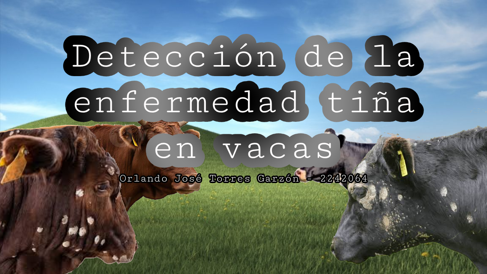

# Detección de la Tiña en Vacas
(Orlando José Torres Garzón - 2242064)

Mi proyecto en esta clase se basa en la clasificación de imagenes para detectar que vacas tienen la enfermedad de la tiña.

Utilizando métodos de machine learning hacemos uso del dataset para entrenar distintos modelos que puedan hacer una clasificación acertada y hagan saber al usuario cuales vacas son más probables a tener la tiña,

Dataset utilizado:
https://www.kaggle.com/datasets/shivamagarwal29/cow-lumpy-disease-dataset

Video explicación y demostración del dataset:
https://www.youtube.com/watch?v=2s0t63VINNo
